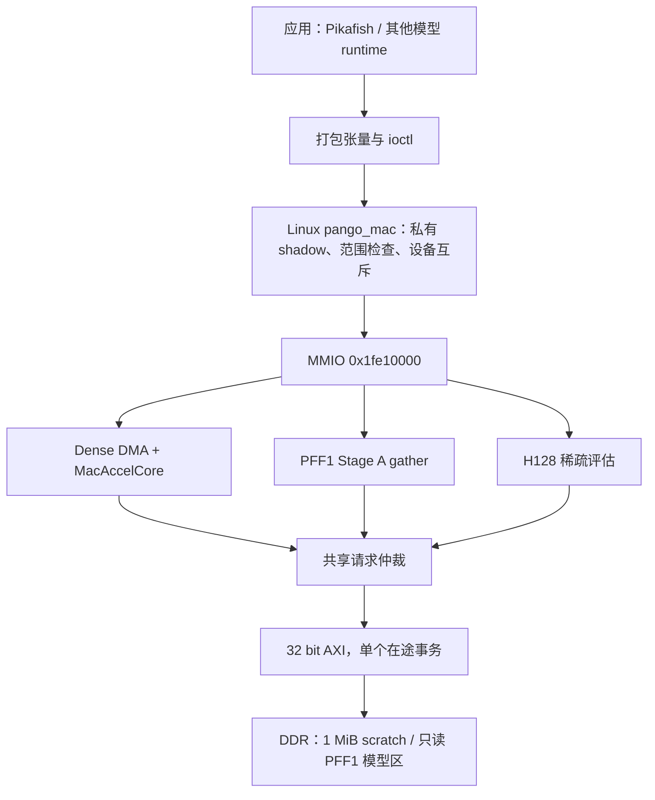

# 加速器架构、调用链与优化建议（2026-10-18）

后续实板补充：同一位流 CoreMark、gather 黄金比对与 resident 测试通过，
3×2 多进程调度失败。原 SD DTB 未声明 gather 所需的 0x200 MMIO 与第二个模型
memory-region；修正 RAM DTB 后 GET_INFO features 为 0x67。
`PIKAFISH_MAC_BACKEND=mmio-shadow` 会强制旧 MMIO 路径；严格 driver 验收需取消该设置。
详见[实板结果和软件修复](CPU_70MHz_Board_Test_20261018.md)。下文保留测试前的分析范围。

## 1. 分析基准与结论

本次依据通过完整 PDS 构建的 CPU 70.875 MHz 候选分析：运行号
`4b7d86bb5f2a4e638b43359196ea52b3`，位流 SHA-256
`0460ab2cf857c406f9018822ff8dc90b7ee8ab620ec03d49ac98aec5f754d84a`。
正式 STA 为 **All Constraints Met**；CPU slow setup WNS +0.166 ns，
slow/fast hold +0.069/+0.052 ns。既有外部 I/O 约束缺口仍保留。
CPU 为 70.875 MHz，**加速器、SYS、CLINT 仍为 49.5 MHz**。
开发目录保留 59.4 MHz 默认配置，冻结候选位于 `G:/fpga/c70retry`。
硬件参数取冻结候选；下文驱动/runtime 取当前开发工程源码，属于静态调用链分析，
不表示这些软件已随新位流完成部署。五个所读 MAC RTL 文件与冻结候选逐哈希一致。

当前结论：矩阵计算核心具备多模式整数计算能力，但装载、提交和数据布局成本值得优先优化；
不宜立即扩大乘法阵列。Pikafish 有现成的 Stage A/B 调用路径；YOLO 完整分割图尚未打通。
这次是源码与已有证据分析，没有修改 RTL、重新布线、运行新增测试或上板。
新位流的 CoreMark、加速器性能及 Linux/GUI/音频并发验收仍待板卡连接。

相关证据：[CPU 候选记录](CPU_70MHz_Optimization_20261017.md)、
[MAC 优化记录](Accelerator_Optimization_20261017.md)、
[整机及模块资源](validation/cpu70-20261017/resource-comparison.json)。

## 2. 架构与实际启用能力



| 引擎 | MMIO 地址 | 本候选状态 | 用途和边界 |
|---|---|---|---|
| Dense MAC + DMA | `0x1fe10000` | 启用 | 分块矩阵乘，Pikafish FC0、通用整数层 |
| 卷积前端 | `0x1fe10040` | **关闭，读回 0** | RTL/软件保留，不能据此认为当前位流支持卷积 ioctl |
| Xiangqi sparse eval | `0x1fe10080` | 启用 | 紧凑 H128 模型的父累加器与子节点增量评分 |
| PFF1 Stage A gather | `0x1fe10100` | 启用 | 官方 PFF1 特征行的加减与 1024 维累加器更新 |

三个启用引擎共享 DDR 访问通道，计算模块分别实现。空闲时请求优先级为
dense → conv（本版关闭）→ sparse → gather；事务获准后保持所有权直到完整响应结束。
这是总线事务仲裁；当前驱动还在设备级串行执行作业，不提供并行推理队列。
请求长度字段支持最多 8 个 32 bit beat，即每 burst 最多 32 B。

### 2.1 Dense 计算与张量限制

| 项目 | 当前配置 |
|---|---|
| 计算模式 | S16×S16、S8×S8、U8×S8；FP8 已关闭 |
| 阵列逻辑并行度 | 每拍 4 输入 × 16 个 S16 输出，或 4 输入 × 32 个 INT8 输出 |
| 单作业维度 | pixels 1..16、Cin 1..256、Cout 1..256，并受权重行数联合限制 |
| 权重缓存 | **64 行 × 128 B = 8 KiB**；通用 RTL 的 1024 行不是当前配置 |
| 累加 / 输出 | 内部 48 bit 累加；输出可选 S8/U8/S16/I32，最终有格式饱和 |
| 激活 | NONE、ReLU、clipped ReLU、squared clipped ReLU；无原生 SiLU |
| DDR scratch | 总线地址 `0x1b000000` 起 1 MiB；CPU uncached alias `0x9b000000` |
| 对齐 | 缓冲区 4 B 对齐、整个访问范围位于合法窗口 |

设 `I=ceil(Cin/4)`；S16 模式 `O=ceil(Cout/16)`，INT8 模式
`O=ceil(Cout/32)`。必须满足 **`I × O ≤ 64`**：

- INT8 256→32：64 行，可执行；256→64：128 行，需要拆分。
- INT8 128→64：64 行，可执行；S16 256→16：64 行，可执行。
- Cin/Cout 单独不超过 256，仍可能被硬件拒绝。

当前 CAP 常量与 GET_INFO 没有完整表达 64 行联合约束及所有模式裁剪。
建议增加版本化能力字段，并让驱动在启动前做同样的组合校验。
现有 Stage A dense 备用路径以 Cout=256 打包，Cin>32 会越过本版行数限制；
正常启用的 gather 路径绕过了这一限制，备用路径不能被宣称覆盖所有 1..256 terms。

**物理打包不是普通连续矩阵**：

- 输入每 4 通道占 8 B，即使 INT8 仍使用 16 bit 槽，低 8 bit 放值。
- 权重每行 128 B，包含 4 个输入槽与交错输出；INT8 两输出共享一个 16 bit 权重槽。
- 若使用 bias，每输出 tile 占 192 B，为 48 bit 槽布局。
- 输出每标量占 **4 B**；S8/S16 结果只在低位有效，负数按其窄类型解释，不能直接当作符号扩展后的 I32。
- 普通右移是算术移位；不能假设与卷积 ABI3 的舍入规则相同。

输入字节数为 `pixels × I × 8`，权重 `I × O × 128`，
bias 为 `O × 192`（zero_bias 时免读），输出为 `pixels × Cout × 4`。

### 2.2 Pikafish 两条主要路径

**Stage A gather**：1024 维 S16 父累加器，加减 1..256 个 S8 特征行；
使用 4 路加减，按模 65536 更新。描述符 bit31 为减法，bit30 选择 PSQ 表，
低 16 bit 为行号，其余位必须为 0。读取 DDR 中的只读官方 PFF1 表，
不是把整个模型装进片上 RAM。每作业需要约 `4096 + 1028×terms` B
有效数据流量（父累加器、描述符、特征行、输出），尚未含协议空隙。

**Stage B FC0**：官方层为 1024→32，16 个 bucket；每次评估拆成
**4 个 256→32 U8×S8 作业**。硬件输出无 bias、无移位、无激活的 I32 部分和；
CPU 将 bias 初始化一次，再按原有整数规则合并四段。后续网络计算保留软件路径。
不能通过更改官方隐藏层规模来声称对同一 Pikafish 模型加速。

独立的 H128 sparse engine 面向另一种紧凑棋类模型：最多 16 个子评分，
每子最多 6 个特征增量，结果经 MMIO 返回。它与官方 PFF1 gather、FC0 应分别验收。

## 3. 如何调用

### 3.1 Linux 推荐调用链

`Pikafish Stage A/B → MacRuntime::Session → /dev/pango-mac0 → pango_mac → MMIO/DMA`

1. `open("/dev/pango-mac0", O_RDWR)`，通过 `PANGO_MAC_IOC_GET_INFO` 核对 ID、版本和 feature。
2. `mmap` 得到当前 fd 的 **1 MiB 私有 shadow**，这是 CPU 缓冲区，不是直接映射设备 DDR。
3. 使用现有转换器/packer 填输入和权重，检查行数、布局和不重叠范围。
4. 以 shadow 内**相对偏移**填写作业；不能把 `0x1b...` 或 `0x9b...` 当成 offset。
5. `RUN` 执行普通 dense；`REGISTER_MODEL` 建立不可变模型快照后可用 `RUN_RESIDENT`。
   Stage A 使用 `RUN_STAGEA`；卷积只有 feature 位存在时才能提交。
6. ioctl 成功后从 shadow 读取输出，检查错误码，记录硬件 cycles 与整个调用耗时。
7. 失败时遵守上层软件回退策略；性能证明必须单独确认没有发生回退。

内核在 `run_lock` 内执行输入/权重复制、寄存器设置、START、带超时轮询和输出复制。
最多 8 个私有 fd context，实际只有一套物理 scratch；8 个 fd 不代表 8 个计算引擎。
当前没有接通供 Linux 使用的完成中断，轮询期间周期性 `cond_resched`，大复制按 4 KiB 分块让出 CPU。
同一 fd 的多线程还需要覆盖“打包—提交—读取”的应用锁。

### 3.2 已有 Pikafish 调用实例

可以直接参考 `pikafish_stageb_accel.cpp` 中的实际 FC0 流程。以下仅展示已准备模型时的单 tile 调用；
权重由既有 PFSB 转换及注册流程生成，输入按上面的 16 bit 槽打包：

```cpp
namespace MR = Stockfish::Eval::NNUE::MacRuntime;
MR::Session session(MR::Client::StageB);
// 先检查 session、取得 shadow 并填入本 tile 的 256 个 U8 输入。
MR::Job job{};
job.pixels = 1;
job.cin = 256;
job.cout = 32;
job.computeMode = MR::ComputeMode::U8S8;
job.outputFormat = MR::OutputFormat::I32;
job.zeroBias = true;
job.inputOffset = MR::StageBInputOffset;
job.weightOffset = /* 既有转换器提供的 bucket/tile 偏移 */ 0;
job.biasOffset = MR::StageBInputOffset;  // zeroBias=true，不读取 bias
job.outputOffset = MR::StageBOutputOffset;
std::uint32_t cycles = 0;
bool ok = session.submit(job, &cycles);
// 必须检查 ok；成功后读 32 个 I32 部分和，再按官方实现合并全部四段。
```

示例中的权重偏移需替换，不能对任意模型直接运行。新模型可使用底层 UAPI，
不宜假装为 StageB 而复用其专用内存约定。
严格驱动验收先取消 `PIKAFISH_MAC_BACKEND=mmio-shadow`，再设置
`PIKAFISH_MAC_REQUIRE_DRIVER=1`，阻止自动 `/dev/mem` 后备；当前实现中显式
mmio-shadow 会强制旧路径，不能只依赖 REQUIRE_DRIVER。
这些配置本身**不能保证整个 NNUE 没有 CPU 回退**，还需检查 Stage A/B 验证模式和统计。
驱动也不支持让其他进程绕过锁同时直接写 MMIO。

### 3.3 “常驻”当前做到哪里

REGISTER_MODEL 将 shadow 模型区保存为内核不可变快照。RUN_RESIDENT 命中 owner 时，
避免 CPU 再次把权重拷到设备 DDR；owner 失效时恢复完整注册区。
PFSB 注册区为 593,920 B，多客户端切换可能触发整区恢复，需单独计时。

**这不是片上权重常驻。** 当前 dense 状态机每个作业仍走
`读输入 → 读权重 → 可选读 bias → 计算 → 写输出`。
后续应分别计数 DDR 常驻命中与片上 tile 命中，不能混用指标。

## 4. 性能和资源判断

满阵列理想值：S16 为 `64×49.5 MHz = 3.168 GMAC/s`，INT8 为
`128×49.5 MHz = 6.336 GMAC/s`。若一次 MAC 算两次操作，分别为
6.336/12.672 GOPS。这些均不是实际模型吞吐。
32 bit AXI 在 49.5 MHz 下的理想数据上界为 198 MB/s，实际还受 DDR 仲裁和协议空隙影响。

现有仿真中，256→32 作业从 **5051 降到 4779 cycles（-5.39%）**；
4779 cycles 在 49.5 MHz 下相当于 96.55 μs 的硬件作业时间，尚未计用户态/内核开销。
同形状 INT8 的有效运算为 8192 MAC，纯计算理想只需 64 拍，
两者差距说明应调查装载、控制和输出阶段；不能把全部差值归为 DDR stall。
该仿真数字不能作为当前位流的板测延迟，也不能直接代表完整 NNUE。

已做的优化包括：64 行权重按 32 bit 字直接写入、AXI AR 请求直发、
首输出同步读与写命令重叠。最后一项在集成 AXI 路径未额外缩短整体作业周期。
不能将它们再次作为未实施方案列出。

| 资源 | 当前整机 | 器件容量 | 算术剩余 |
|---|---:|---:|---:|
| LUT | 43,337 | 66,600 | 23,263 |
| DRM（36 Kbit 等效） | 120.5 | 155 | 34.5 |
| APM | 177 | 240 | 63 |

MAC 子系统本身综合占 **9439 LUT、10845 FF、8 DRM、173 APM**；
其中并非全部 APM 都只是阵列中的乘法器。不能把整机 177 APM 等同于 177 个 MAC。
剩余资源还受放置、布线和 hold 修复限制；CPU setup 余量只有 0.166 ns，
“容量能放下”不足以保证增强硬件后时序仍通过。

## 5. 建议优化顺序

| 优先级 | 具体工作 | 预期作用 | 成本及关键边界 |
|---|---|---|---|
| P0 | 分阶段计时与能力契约完善 | 明确 CPU 打包/复制/锁等待、DMA、计算、后处理占比；启动前拒绝超限形状 | 优先使用现有计数器；绝对时间用独立 CLINT 校准；不将父子计时重复相加 |
| P1 | FC0 四 tile 批量提交，硬件/驱动连续处理并合并部分和 | 减少 4 次 ioctl、重复启动与输出往返 | 用新增能力/ABI；bias 一次，完整 K 后才激活/量化，保持官方整数语义 |
| P1 | 在 DDR 常驻之上增加片上权重 tile 复用 | 直接减少重复权重 DMA | 需 model ID、generation、tile、owner 标签，覆盖写入、复位、超时及多客户端失效 |
| P1 | 相同权重处理更多有效 pixels | 摊薄装载成本，适用于卷积/批处理 | 当前最多 16 pixels；StageB 四段输入不同，不能误称同一输入可复用 |
| P2 | 双缓冲装载/计算、较长 burst 或多在途请求 | 隐藏或减少总线等待 | 当前串行 DMA 需改状态机；保持 4 KiB 边界、背压、abort/drain、地址校验 |
| P2 | 片上窗口/行缓存并复用现有 MAC 阵列 | 减少 YOLO CPU im2col、重复像素读取 | 恢复卷积能力需综合和整机 STA；不是仅把 ENABLE_CONV 改为 1 |
| P3 | 依据综合拆分结果改缓存银行/宽选择器/DSP 映射 | 降低 LUT/FF/APM，释放增强空间 | 保持端口、容量、同步读周期；不能通过缩减官方模型或关闭必要功能获得收益 |
| P3 | 获得资源余量后适度扩阵列/独立提 MAC 时钟 | 提高计算上界 | 只有确认核心算力是瓶颈才做；需独立时钟/CDC、全时序角及共享 DDR 带宽预算 |

片上 8 KiB 权重缓存只能保留一个最大 256→32 tile。
四 tile 合计 32 KiB，全 16 bucket FC0 权重约 512 KiB；不能承诺把全部官方 FC0 常驻 BRAM。
扩大权重缓存也会增加宽读端口和选择逻辑。可先按命中率评估单 tile 保留、
两个 bank 的乒乓装载或小规模多 tile 缓存，再选容量。
扩大到原通用 1024 行是 128 KiB 权重存储，不能忽略本器件仅剩 34.5 DRM 的整机余量。

若增加异步队列/中断，需同时定义 Pikafish、视觉和音频任务的优先级与最长等待时间。
现有 XQT1 语音识别仍在 CPU 中运行；把小全连接层拆成很多 ioctl，可能被提交和打包成本抵消，
应比较整段推理而不是单个乘法。不得为提升视觉吞吐而降低 Pikafish 或语音实时性。

## 6. 对 YOLOv5n-seg 320、15 类、30 fps 的含义

1. 当前通过时序的位流没有启用卷积前端；dense 可配合 CPU 展开映射部分卷积，
   但这不代表已支持完整 YOLO 分割网络。
2. 保留的卷积 ABI2 仅窗口流探针，不产生卷积输出；ABI3 计算路径限制
   Cin≤4、Cout≤16、K≤128、channel_tile=0，且 SiLU 在 CPU 上执行。
   不能把这一路径当作深层通道的完整通用卷积实现。
3. 加窗口前端能减少像素搬运和 CPU 展开，**不会减少相同卷积的数学 MAC 数**。
   卷积滑窗、权重复用、更多 pixels 和 DMA 重叠应一起规划。
4. 30 fps 每帧仅 33.33 ms。按当前 INT8 峰值，每帧理想运算预算
   **211.2 M MAC（0.4224 GOP，按两操作/MAC）**，还未预留采集、DDR、
   SiLU、Concat、上采样、Detect、mask 与 NMS。
   应对实际导出图逐层统计 MAC、tile 数与搬运字节，不能拿模型文件大小或 CPU 提频推断帧率。
5. 可以尝试减小 YOLO width/depth、输入或分割分支规模并重新训练/校准，
   需独立测试集验证棋子小目标、遮挡及掩膜质量。此修改只针对视觉模型，
   官方 Pikafish 权重、维度、量化及运行接口继续保留。

建议先选择一个真实 3×3 层和一个 1×1 层建立窗口复用与 dense 的完整成本对照，
然后估算整图；只有整图预算闭合后，才决定是否增 DSP 或缩减模型。
历史卷积探针与旧 CPU 的 NNUE 时间均属于不同候选，不能用于证明本版 30 fps 或 NNUE 10 ms。

## 7. 后续实施验收要求

本节是下一步实施条件，本次未执行：

- 固定模型/输入与工作量，先写正确性、周期、字节和非法输入检查，再改实现。
- 对旧 dense、FP8 通用配置、Stage A/B、H128 sparse 做位精确回归；检查饱和、
  模 65536、深 K 合并、尾通道、超时、背压、多 fd owner 切换。
- 比较同版整机 ADS 资源，收益明确后按项目预算进入 PnR，检查全部时序角。
- 实板用精确绑定的候选核对 CoreMark、Stage A/B、完整 NNUE、音频及 GUI 并发；
  分别给出硬件作业、完整推理、音频溢出和 P50/P95。
- 在这些证据齐备前，结论维持“优化方案/候选”，不宣称新位流性能达标。

## 8. 代码入口

| 内容 | 路径 |
|---|---|
| 实际引擎开关、时钟和 DDR 接入 | `rtl/soc/soc_top.v`（分析冻结候选同名文件） |
| MMIO 子窗口、共享仲裁 | `rtl/mac_accel/mac_accel_ddr_kernel_top.v` |
| 行数校验、装载状态机、寄存器 | `rtl/mac_accel/mac_accel_dma_kernel.v` |
| 阵列、48 bit 累加与整数输出 | `rtl/mac_accel/MacAccelCore.v` |
| 官方 PFF1 gather | `rtl/mac_accel/pff1_stagea_gather.v` |
| 紧凑 H128 评估 | `rtl/mac_accel/xiangqi_sparse_eval.v` |
| ABI、ioctl 和描述符 | `linux/mac_accel/pango_mac_uapi.h` |
| Linux owner、复制、常驻、轮询 | `linux/mac_accel/kernel/pango_mac.c` |
| 用户态共享 Session | `linux/pikafish/pikafish_mac_runtime.h`、`.cpp` |
| 官方 FC0 四作业示例 | `linux/pikafish/pikafish_stageb_accel.cpp` |
| gather 优先及 dense 备用路径 | `linux/pikafish/pikafish_stagea_accel.cpp` |
| 现有打包/模型工具 | `sw/pikafish_mlp_stage_b/` 及 `linux/pikafish/` 中 StageB pack 工具 |
